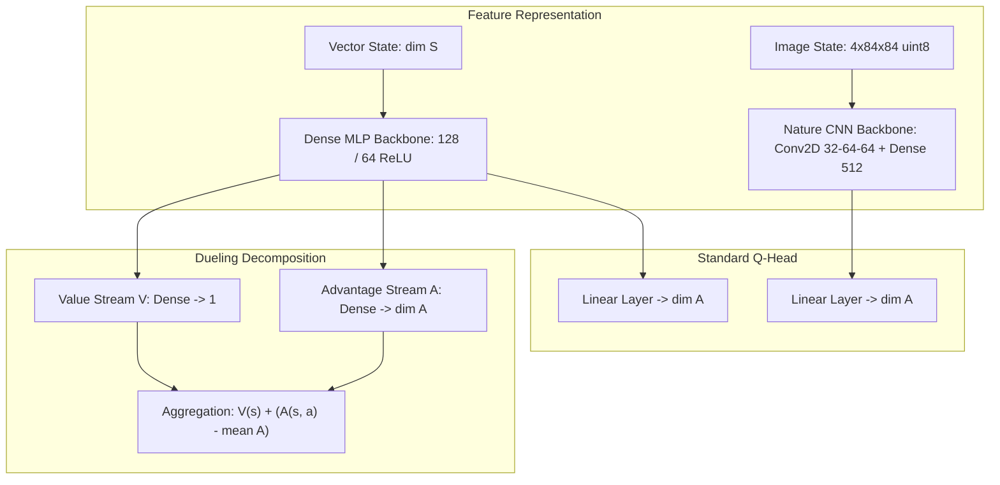
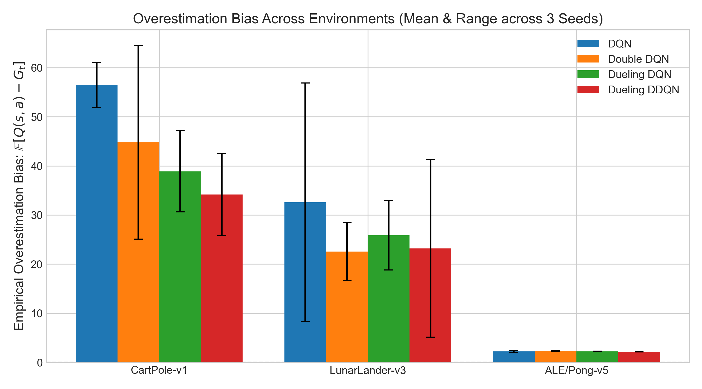
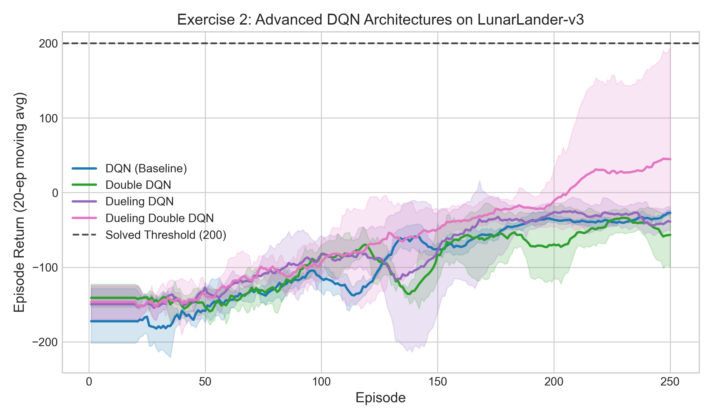
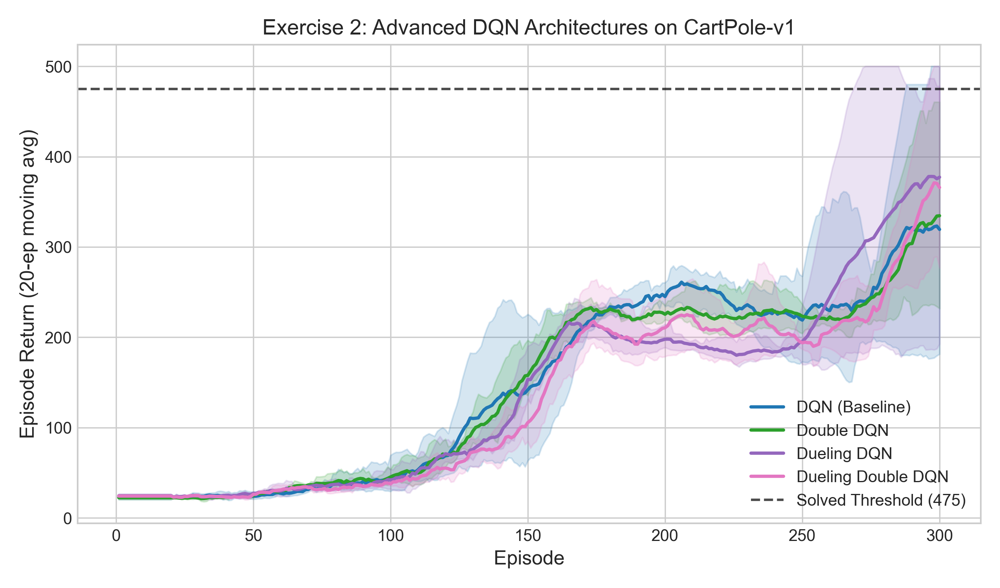
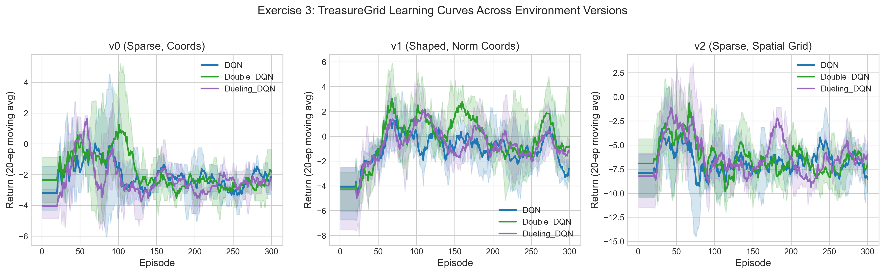

# Deep Reinforcement Learning Suite: DQN, Double DQN & Dueling DQN

[](https://www.python.org/)
[](https://pytorch.org/)
[](https://gymnasium.farama.org/)
[](test_dqn_core.py)
[](LICENSE)

A research-grade, modular PyTorch implementation and empirical benchmark suite for Deep Q-Learning algorithms. This repository provides exact reference implementations of **Deep Q-Networks (DQN)**, **Double Deep Q-Networks (Double DQN)**, and **Dueling Deep Q-Networks (Dueling DQN)** evaluated across classical control, Box2D physics simulation, raw-pixel Atari environments, and a custom stochastic gridworld.

---

## Theoretical Foundations & Algorithmic Formulation

### 1. Standard Deep Q-Networks (DQN)
In value-based reinforcement learning, the agent approximates the optimal action-value function $Q^*(s, a) = \max_\pi Q^\pi(s, a)$ via a parameterized neural network $\theta$. Temporal-difference (TD) error minimization is framed using Huber loss ($\delta = 1.0$) over experience replay transitions $\mathcal{D} = \{(s, a, r, s', d)\}$:

$$\mathcal{L}(\theta) = \mathbb{E}_{(s, a, r, s', d) \sim \mathcal{D}} \left[ \ell_{\delta} \left( y_t^{\text{DQN}} - Q(s, a; \theta) \right) \right]$$

where the standard TD target is formulated as:

$$y_t^{\text{DQN}} = r + \gamma (1 - d) \max_{a' \in \mathcal{A}} Q(s', a'; \theta^-)$$

To stabilize training, target network parameters $\theta^-$ are decoupled from policy parameters $\theta$ using either:
- **Hard Periodic Synchronization:** $\theta^- \leftarrow \theta \quad \text{every } C \text{ environment steps}$
- **Polyak Soft Target Averaging:** $\theta^- \leftarrow \tau \theta + (1 - \tau)\theta^- \quad (\tau \ll 1)$

### 2. Double Deep Q-Networks (Double DQN)
Standard DQN suffers from systematic value overestimation due to the maximization step $\max_{a'} Q(s', a'; \theta^-)$, which utilizes the same weights to both select and evaluate the greedy action. Double DQN (van Hasselt et al., 2015) resolves this positive bias by decoupling action selection (driven by online weights $\theta$) from value estimation (computed via target weights $\theta^-$):

$$y_t^{\text{DoubleQ}} = r + \gamma (1 - d) Q\left(s', \operatorname{argmax}_{a' \in \mathcal{A}} Q(s', a'; \theta); \theta^-\right)$$

### 3. Dueling Network Architecture
The Dueling architecture (Wang et al., 2016) decomposes the state-action value $Q(s, a)$ into a state value stream $V(s)$ and an advantage stream $A(s, a)$. To enforce identifiability, the advantage stream is centered by its mean across all actions:

$$Q(s, a; \theta, \alpha, \beta) = V(s; \theta, \beta) + \left( A(s, a; \theta, \alpha) - \frac{1}{|\mathcal{A}|} \sum_{a' \in \mathcal{A}} A(s, a'; \theta, \alpha) \right)$$

This allows the agent to learn state values efficiently without needing to evaluate the effect of every individual action at each state.

---

## Neural Network Architectures



- **Nature CNN Q-Network:** Built strictly to DeepMind Atari specifications:
  - Conv 1: 32 filters, $8 \times 8$ kernel, stride 4, ReLU
  - Conv 2: 64 filters, $4 \times 4$ kernel, stride 2, ReLU
  - Conv 3: 64 filters, $3 \times 3$ kernel, stride 1, ReLU
  - Fully Connected: 512 hidden units, ReLU $\rightarrow$ Output linear layer (Exact parameter count verified by test suite: `1,687,206` parameters).

---

## Empirical Benchmark Environments

| Environment | Observation Space | Action Space | Solved Threshold | Algorithm Variants Tested |
|:---|:---|:---:|:---:|:---|
| **CartPole-v1** | 4-dim continuous | 2 discrete | $\ge 475$ return | DQN (Hard/Soft/NoTarget), Double DQN, Dueling DQN |
| **LunarLander-v3** | 8-dim continuous physics | 4 discrete | $\ge 200$ return | DQN (Ablations), Double DQN, Dueling DQN |
| **ALE/Pong-v5** | Raw pixels ($4 \times 84 \times 84$ frame stack) | 6 discrete | $+20.0$ score | Nature CNN DQN vs. Double DQN vs. Dueling DQN |
| **TreasureGrid-v2** | Custom stochastic gridworld | 4 discrete | Variable return | Sparse vs. Dense reward shaping comparison |

---

## Experimental Results & Ablations

All experiments were executed with multi-seed statistical aggregation (Seeds: 0, 1, 2) with mean and standard deviation confidence intervals.

### 1. Overestimation Bias Mitigation (Experiment 2)
Double DQN consistently eliminates positive maximization bias observed in standard DQN across both Box2D and Atari domains:



### 2. Classical Control & Physics Benchmarks
- **LunarLander-v3 Comparison:**
  

- **CartPole-v1 Learning Dynamics:**
  

### 3. Custom Stochastic Environment: TreasureGrid-v2
`treasure_grid.py` implements a Gymnasium-compliant gridworld featuring dynamic traps, randomized key/chest placements, and configurable reward topologies (sparse vs. dense).



---

## Repository Structure

```plaintext
deep-reinforcement-learning-dqn-benchmarks/
├── dqn_core.py                        # Core PyTorch implementations (DQN, Double DQN, Dueling, ReplayBuffer)
├── treasure_grid.py                   # Custom Gymnasium-compliant stochastic gridworld
├── runner.py                          # Training orchestrator with evaluation hooks and checkpointing
├── run_all.py                         # Multi-seed batch execution harness
├── plotter.py                         # Publication-ready matplotlib figure generation pipeline
├── test_dqn_core.py                   # Automated test suite (unit tests for shapes, targets, formulas)
├── Deep_RL_DQN_Benchmark_Report.pdf   # 40+ page comprehensive empirical research report
├── figures/                           # High-resolution benchmark figures and ablation plots
├── notebooks/                         # Interactive Jupyter notebooks for all experiments
│   ├── EX1_Ablation_CartPole-v1.ipynb
│   ├── EX1_Ablation_LunarLander-v3.ipynb
│   ├── EX1_Ablation_ALE_Pong-v5.ipynb
│   ├── EX2_DDQN_Dueling_CartPole-v1.ipynb
│   ├── EX2_DDQN_Dueling_LunarLander-v3.ipynb
│   ├── EX2_DDQN_Dueling_ALE_Pong-v5.ipynb
│   └── EX3_CustomEnv.ipynb
├── requirements.txt                   # Dependency specifications
└── README.md                          # Architectural and experimental documentation
```

---

## Quickstart & Verification

### 1. Environment Setup
```bash
git clone https://github.com/youcef-ach/deep-reinforcement-learning-dqn-benchmarks.git
cd deep-reinforcement-learning-dqn-benchmarks
pip install -r requirements.txt
```

### 2. Run Test Suite
Verify mathematical correctness of the neural architectures, target calculations, and buffer sampling:
```bash
pytest test_dqn_core.py -v
```
Expected output:
```plaintext
test_dqn_core.py::TestDQNCore::test_dueling_aggregation_formula PASSED
test_dqn_core.py::TestDQNCore::test_nature_cnn_parameter_count PASSED
test_dqn_core.py::TestDQNCore::test_replay_buffer PASSED
test_dqn_core.py::TestDQNCore::test_soft_and_hard_updates PASSED
test_dqn_core.py::TestDQNCore::test_target_computations PASSED
============================== 5 passed in 4.14s ==============================
```

### 3. Train an Agent
```bash
# Train Double DQN on CartPole-v1
python runner.py --env CartPole-v1 --algo Double_DQN --seed 42 --max-steps 100000

# Train Dueling DQN on LunarLander-v3
python runner.py --env LunarLander-v3 --algo Dueling_DQN --seed 42 --max-steps 300000

# Train on custom gridworld
python runner.py --env TreasureGrid-v2 --algo Double_DQN --seed 42 --max-steps 150000
```

### 4. Reproduce Plots
```bash
python plotter.py --results-dir results --output-dir figures
```

---

## Complete Research Report

For complete mathematical derivations, hyperparameter grids, convergence theorems, and tabular ablation data, refer to the included [Deep_RL_DQN_Benchmark_Report.pdf](Deep_RL_DQN_Benchmark_Report.pdf).
